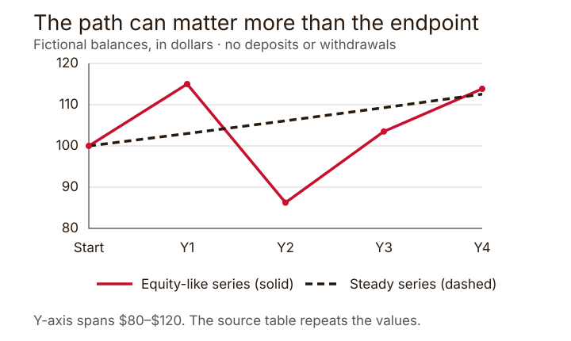

# Read a Market History Without Treating It as a Promise

A chart ends higher than it started. A reader calls it a safe path. That conclusion is stronger than the chart. To see why, compute wealth through a short record rather than looking only at its endpoints.

## A complete, fictional sample

These four labeled years are invented; they do not describe U.S. stocks, bonds, inflation or any public index. Both series are nominal annual **total** returns with distributions included under a reinvestment convention. They exclude fees and taxes. Every return is for one whole year. Start each at $100, with no later deposits or withdrawals.

| Year | Equity-like teaching series | Steady teaching series |
| --- | ---: | ---: |
| Y1 | +15% | +3% |
| Y2 | −25% | +3% |
| Y3 | +20% | +3% |
| Y4 | +10% | +3% |

The first series goes to 115, then 86.25, then 103.50, then 113.85. Its full-sample total gain is 13.85%. Compounding at a constant rate to the same endpoint would give about 3.30% per year. The steady series ends about $112.55. Ending wealth was close, but a learner who withdrew during the second year's drop did not get to spend the ending value. In the first series, a loss of 25% from 115 requires a gain of one-third from 86.25 to return to 115, not just 25%.

| Date | Equity-like balance ($) | Steady balance ($) |
| --- | ---: | ---: |
| Start | 100.00 | 100.00 |
| End Y1 | 115.00 | 103.00 |
| End Y2 | 86.25 | 106.09 |
| End Y3 | 103.50 | 109.27 |
| End Y4 | 113.85 | 112.55 |

## Write the certificate a real chart would need

A return series has a population and a method. Write the country, population of securities, start/end observations, frequency, currency and reinvestment treatment before labeling a line. An index level change need not include payouts. A yield quote is not itself a realized holding-period bond return. If a share starts at $100, ends at $105 and pays $3 during a single period with no modeled reinvestment, this simple period's total return is 8%, while the price alone rises 5%.

A study built only from securities still listed at the end can miss earlier failures. That is one form of survivorship bias. A recent period may also differ from longer history. No figure in the synthetic table tests either bias empirically. For a real-data extension use a versioned, rights-cleared source, keep its definitions and extraction date with the data, and distinguish named index performance from a claim about the entire economy or a forecast. Keep CPI series and exact dates if you convert to purchasing power.

## A bounded check against published U.S. fund history

The U.S. Federal Retirement Thrift Investment Board's investment reviews show the TSP funds' **net** returns for the relevant calendar year, not a promise or a summary of every U.S. stock and bond. In [the 2022 review](https://www.frtib.gov/pdf/minutes/2023/Jan/Att4-December-2022-Investment-Program-Review.pdf), the F Fund (fixed income) is reported at −12.83% and the C Fund (large-cap equity) at −18.13%. In [the 2023 review](https://www.frtib.gov/pdf/minutes/2024/Jan/Att2-December-2023-Investment-Program-Review.pdf), the corresponding net figures are +5.58% and +26.25%. These figures come from the net fund row, not the reports' benchmark or fund-manager rows. The two dates were chosen to demonstrate a reversal, not as a representative sample.

Apply each reported net-return sequence to an illustrative $100 with no personal contributions or withdrawals. The two endpoints would be $92.03 and $103.36, respectively. Both reported funds lost money in 2022, a counterexample to the claim that a stock and fixed-income holding must move in opposite directions every year. Two net fund observations per series do not establish an expected correlation, annual rate or recommendation, and the table at the start of this chapter remains entirely fictional.

**Teardown.** “The equity-like series finished higher, so it would be safer for a bill due after Y2.” Which horizon did the answer silently change? Use both year-two balances before making any assessment of that bill.

**Transfer.** Change Y4 of the first series from +10% to −10%; rebuild the ending wealth and total return. Explain why result sensitivity to one chosen ending date matters in a comparison of actual histories.

[Contents](../README.md)
